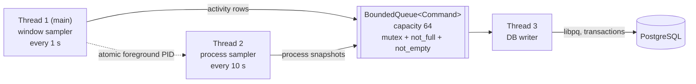

<div align="center">


<p>
  
  
  
  
  
  
</p>

**A study and work tracker for Windows.** It records which app and window you are using, splits your time into sessions, labels activity as *productive*, *neutral* or *distracting*, measures how much CPU every process really uses, and can block distracting apps while you focus.

[Features](#-features) · [OS concepts](#-os-concepts) · [Database](#-database-design) · [Getting started](#-getting-started) · [Project structure](#-project-structure)

</div>

---

## ✨ Features

<table>
<tr>
<td width="50%" valign="top">

### 🖥️ Activity tracking
Polls the foreground window every second (`GetForegroundWindow`) and records the app, window title and time of every stretch of activity. Short blips (Alt+Tab passing through a window) are filtered out by a 2-second switch debounce.

</td>
<td width="50%" valign="top">

### ⚙️ Process & CPU monitor
Every 10 s, snapshots all running processes: PID, parent PID, threads, priority class, memory and the CPU time the scheduler gave each one. Shows which apps burn CPU while you are not even looking at them.

</td>
</tr>
<tr>
<td valign="top">

### 🏷️ Rules + AI categories
Apps have a default category; each user can override it. Browser tabs are classified by a **TF-IDF + Naive Bayes** model, applied only when it is at least 70% confident.

</td>
<td valign="top">

### 🎯 Focus Mode
`--focus` minimises any app the user has marked distracting the moment it comes to the front (or closes it with `--terminate`). `--minutes 25` ends a timed focus session.

</td>
</tr>
<tr>
<td valign="top">

### 💤 Idle detection
`GetLastInputInfo` detects when there has been no keyboard or mouse input (default 120 s), so time away from the desk isn't counted as work.

</td>
<td valign="top">

### 📊 Dashboard
Flask + Chart.js: totals, focus score per session, a timeline of each session, top apps, foreground-vs-CPU and background processes, and per-user category settings.

</td>
</tr>
</table>

## 🧠 OS concepts

The tracker runs **three threads** that communicate through a **bounded buffer**:



| Topic | Where | What it shows |
|---|---|---|
| **Threads & synchronisation** | `include/bounded_queue.h`, `src/async_writer.cpp`, `include/log.h` | Producer/consumer with a **bounded buffer**: one mutex for mutual exclusion and two condition variables. Producers block while the buffer is full (back-pressure), the consumer blocks while it is empty; neither busy-waits. `close()` lets the writer drain the queue on shutdown. A second mutex serialises use of the non-thread-safe `PGconn`, a third serialises console output (an early test run printed interleaved text from two threads). `std::atomic` shares the stop flag and the foreground PID. |
| **Process management** | `src/process_monitor.cpp`, `src/focus_mode.cpp` | Enumerates processes with `CreateToolhelp32Snapshot`; reads parent PID, thread count, base priority and priority class, and working-set memory. Detects PID reuse by comparing process creation times. Focus Mode minimises or terminates processes (`TerminateProcess`). |
| **CPU scheduling** | `src/process_monitor.cpp`, view `vw_foreground_vs_cpu` | CPU % = Δ(kernel + user time from `GetProcessTimes`) ÷ (wall time × logical CPUs). The view compares how long an app was **in front of you** with how much **CPU time it was scheduled for**: an editor in front for an hour can use seconds of CPU while a background app burns CPU unseen. |
| **Signals / shutdown** | `src/main.cpp` | Console control handler for Ctrl+C *and* closing the window: it waits (up to Windows' ~5 s limit) until the queue is drained and the session closed. |

Unit tests in `tracker/tests/` cover the session logic and stress the queue with 4 producer threads × 20 000 items through an 8-slot buffer (nothing lost or duplicated; producers wait thousands of times for space).

## 🗄️ Database design

PostgreSQL, normalised (`db/schema.sql`):

```text
categories ──< applications ──< activity_log >── sessions >── users
     │               │               │                          │
     │               └──< process_samples >── sessions          │
     └──< user_app_category >───────────────────────────────────┘
activity_log ──1:1── ai_predictions        title_training_samples
```

- **Effective category** of an activity (view `vw_activity`): the user's own category for the app → the AI label for that row → the app's default. The order is one `COALESCE` and is a deliberate design decision: with this order, marking Chrome *productive* also makes YouTube tabs productive.
- **Constraints** do the validation: `CHECK` on times, PIDs, CPU %, confidence; foreign keys with `ON DELETE CASCADE`; lower-case process names.
- **Views**: `vw_session_productivity`, `vw_session_app_usage`, `vw_daily_productivity`, `vw_foreground_vs_cpu`, `vw_background_cpu`.
- **Transactions**: batches of activity rows and process samples are inserted atomically; the classifier writes its labels and audit rows in one transaction.

## 🚀 Getting started

> **Requirements:** Windows 10/11 · PostgreSQL 14+ · CMake ≥ 3.20 · MinGW-w64 GCC or Visual Studio (C++17) · Python 3.10+

<details>
<summary><b>1. Create the database</b></summary>

```powershell
powershell -ExecutionPolicy Bypass -File db\setup.ps1
```

This creates the login `focus_user` and the database `study_tracker`, then loads `schema.sql` and `logic.sql`. The `focus_user` password is generated and saved in `%APPDATA%\postgresql\pgpass.conf`, which psql, the tracker and the Python tools read automatically, so no password is stored in the project. (The script needs the `postgres` superuser password, from pgpass.conf or typed when asked.)

`tracker/config.ini` (git-ignored) holds the connection settings:

```ini
[database]
host = localhost
port = 5432
user = focus_user
database = study_tracker
```

</details>

<details>
<summary><b>2. Build and run the tracker</b></summary>

```powershell
cd tracker
cmake -S . -B build -G Ninja -DCMAKE_BUILD_TYPE=Release
cmake --build build
.\build\focus_tests.exe               # unit tests
.\build\focus_tracker.exe             # Ctrl+C or close the window to stop
```

CMake finds the newest PostgreSQL under `C:/Program Files/PostgreSQL` (or pass `-DPG_ROOT=...`) and copies `libpq.dll` and its DLLs next to the `.exe`.

```text
focus_tracker [options]
  --config <path>    INI file with a [database] section (default config.ini)
  --user <id>        user id (default 1)
  --name <name>      user display name
  --idle <sec>       idle threshold in seconds (default 120)
  --poll <sec>       window polling interval (default 1)
  --proc <sec>       process/CPU snapshot interval (default 10, 0 = off)
  --minutes <n>      stop by itself after n minutes, e.g. 25 (default: until Ctrl+C)
  --focus            enable Focus Mode (block 'distracting' apps)
  --block <exe>      extra process to block (repeatable)
  --terminate        kill blocked apps instead of minimising
```

</details>

<details>
<summary><b>3. Dashboard</b></summary>

```powershell
cd tracker\dashboard
pip install -r requirements.txt
python server.py        # http://127.0.0.1:8000
```

</details>

<details>
<summary><b>4. Train and run the title classifier</b></summary>

Add labelled examples to `title_training_samples` (labels `productive`, `neutral`, `distracting`; at least 15, ideally 20+ distinct titles), then:

```powershell
pip install scikit-learn joblib "psycopg[binary]"
python ai\title_classifier.py train                # prints held-out accuracy vs a baseline
python ai\title_classifier.py classify             # labels new browser rows (≥ 70% confidence)
python ai\title_classifier.py classify --recheck   # re-label everything after retraining
```

Every prediction is stored in `ai_predictions` (also the ones not applied), so accuracy can be audited later.

</details>

## 🗂️ Project structure

```text
FocusOs/
├── db/
│   ├── schema.sql         tables, constraints, seed categories and apps
│   ├── logic.sql          report views
│   └── setup.ps1          creates role + database, loads both files
├── tracker/
│   ├── include/, src/     C++17 tracker (3 threads, libpq, Win32)
│   ├── tests/             unit tests: session logic + bounded buffer
│   └── dashboard/         Flask API + static dashboard
└── ai/
    └── title_classifier.py  TF-IDF + Naive Bayes window-title classifier
```

## ⚠️ Known limitations

- Watching a video without touching the keyboard or mouse counts as **idle** after 2 minutes.
- Process snapshots keep only the busiest processes (≥ 0.5% CPU, top 20) plus the foreground one, so CPU time of very quiet processes is under-counted.
- Protected system processes cannot be opened without admin rights and are skipped.
- Report days are UTC days (see the note at the top of `db/logic.sql` to use India time).

## 🔒 Privacy

Everything stays on your computer: window titles are stored only in your local PostgreSQL database and never sent anywhere.

<div align="center">


</div>
