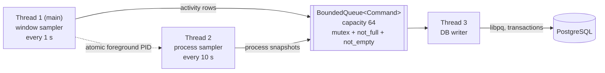

<div align="center">


<p>
  
  
  
  
  
  
</p>

**A study and work tracker for Windows.** It records which app and window you are using, splits your time into sessions, labels activity as *productive*, *neutral* or *distracting*, measures how much CPU every process really uses, and can block distracting apps while you focus.

[Features](#-features) · [OS concepts](#-os-concepts) · [Database](#-database-design) · [Getting started](#-getting-started) · [Project structure](#-project-structure)

</div>

---

## ✨ Features

<table>
<tr>
<td width="50%" valign="top">

### 🖥️ Activity tracking
Polls the foreground window every second (`GetForegroundWindow`) and records the app, window title and time of every stretch of activity. Short blips (Alt+Tab passing through a window) are filtered out by a 2-second switch debounce.

</td>
<td width="50%" valign="top">

### ⚙️ Process & CPU monitor
Every 10 s, snapshots all running processes: PID, parent PID, threads, priority class, memory and the CPU time the scheduler gave each one. Shows which apps burn CPU while you are not even looking at them.

</td>
</tr>
<tr>
<td valign="top">

### 🏷️ Rules + AI categories
Apps have a default category that you can change. Browser tabs are categorised per website: built-in and your own website rules first, then a **TF-IDF + Complement Naive Bayes** model that reads the tab title, applied only when it is confident enough.

</td>
<td valign="top">

### 🎯 Focus Mode
Turn the timer wheels to any length (1 minute to 8 hours), pick breaks if you want them, and press **Start focus** in the dashboard: any app on your block list is closed or minimised the moment it comes to the front, except during a break. Add or remove blocked apps right there. From the terminal: `--focus --minutes 90 --break-every 50 --break 10`.

</td>
</tr>
<tr>
<td valign="top">

### 💤 Idle detection
`GetLastInputInfo` detects when there has been no keyboard or mouse input (default 120 s), so time away from the desk isn't counted as work.

</td>
<td valign="top">

### 📊 Dashboard
Flask + Chart.js: totals, focus score per session, a timeline of each session, top apps, foreground-vs-CPU and background processes, and your category settings. FocusOs is single-user: one PC, one person. Frosted-glass look by default (switch to **Classic** in the top bar) and **Auto / Light / Dark** colour mode; both choices are remembered.

**Desktop app:** the dashboard runs in its own Windows window (`desktop.py`: Flask on a background thread + an Edge WebView2 window via pywebview), with its own icon and taskbar entry, no browser or address bar. A named mutex keeps it single-instance (opening it again brings the existing window forward), and closing the window stops the portable database unless a focus session is still running. `start.bat --browser` still opens it in a browser instead.

</td>
</tr>
</table>

## 🧠 OS concepts

The tracker runs **three threads** that communicate through a **bounded buffer**:



| Topic | Where | What it shows |
|---|---|---|
| **Threads & synchronisation** | `include/bounded_queue.h`, `src/async_writer.cpp`, `include/log.h` | Producer/consumer with a **bounded buffer**: one mutex for mutual exclusion and two condition variables. Producers block while the buffer is full (back-pressure), the consumer blocks while it is empty; neither busy-waits. `close()` lets the writer drain the queue on shutdown. A second mutex serialises use of the non-thread-safe `PGconn`, a third serialises console output (an early test run printed interleaved text from two threads). `std::atomic` shares the stop flag and the foreground PID. |
| **Process management** | `src/process_monitor.cpp`, `src/focus_mode.cpp` | Enumerates processes with `CreateToolhelp32Snapshot`; reads parent PID, thread count, base priority and priority class, and working-set memory. Detects PID reuse by comparing process creation times. Focus Mode minimises or terminates processes (`TerminateProcess`). |
| **CPU scheduling** | `src/process_monitor.cpp`, view `vw_foreground_vs_cpu` | CPU % = Δ(kernel + user time from `GetProcessTimes`) ÷ (wall time × logical CPUs). The view compares how long an app was **in front of you** with how much **CPU time it was scheduled for**: an editor in front for an hour can use seconds of CPU while a background app burns CPU unseen. |
| **Inter-process communication** | `src/main.cpp`, `dashboard/focus_control.py` | Two **named kernel objects** link the dashboard and the tracker. A **named mutex** (`FocusOs.Running`) allows only one tracker at a time (a second one would count every second twice); Windows releases it even if the tracker crashes, so it can never go stale like a lock file. A **named event** (`FocusOs.Stop`) is how the dashboard's *End now* button (or `focus_tracker --stop`) asks the tracker to stop: the tracker's threads block on the event in the kernel and wake immediately, then shut down cleanly. |
| **Signals / shutdown** | `src/main.cpp` | Console control handler for Ctrl+C *and* closing the window: it waits (up to Windows' ~5 s limit) until the queue is drained and the session closed. |

Unit tests in `tracker/tests/` cover the session logic and stress the queue with 4 producer threads × 20 000 items through an 8-slot buffer (nothing lost or duplicated; producers wait thousands of times for space).

## 🗄️ Database design

PostgreSQL, normalised (`db/schema.sql`):

```text
categories ──< applications ──< activity_log >── sessions >── users
     │               │               │                          │
     │               └──< process_samples >── sessions          │
     └──< user_app_category >───────────────────────────────────┘
activity_log ──1:1── ai_predictions        title_training_samples
```

- **Effective category** of an activity (view `vw_activity`): the most specific information wins: a **website rule** matching a browser tab's title (`site_rules`, e.g. "instagram" → distracting) → the **AI label** for that row (a YouTube lecture vs a prank video) → the user's own category for the whole app → the app's default. Website rules are matched by the stored function `site_rule_category()`, the user's own rules before built-in ones and longer patterns before shorter ones. The order is one `COALESCE`; with it, marking Chrome *productive* no longer makes Instagram productive.
- **Browser tabs are categorised automatically:** rules apply instantly inside the database (also to the tab open right now), and the dashboard runs the AI on new browser rows every minute. Add your own rules in **Focus mode → Websites in your browser**. Windows only exposes the page *title*, not the URL, so a site is recognised by its name in the title (Instagram, Netflix, "#shorts"); for YouTube the AI reads the video title.
- **Constraints** do the validation: `CHECK` on times, PIDs, CPU %, confidence; foreign keys with `ON DELETE CASCADE`; lower-case process names.
- **Views**: `vw_session_productivity`, `vw_session_app_usage`, `vw_daily_productivity`, `vw_foreground_vs_cpu`, `vw_background_cpu`.
- **Focus sessions**: `sessions.planned_minutes` (completed vs ended early), `sessions.break_every_min` / `break_min` (the break plan), `focus_blocks` (every app Focus Mode pushed away) and `session_live` (one row per running session with the window in front right now, upserted every 5 s and deleted at stop, because `activity_log` only gets a row once you switch away).
- **Transactions**: batches of activity rows and process samples are inserted atomically; the classifier writes its labels and audit rows in one transaction.

## 🚀 Getting started

### Quick start: no database to install

1. Download the release zip (`FocusOs-<date>.zip`) and unzip it, for example into Documents.
2. Double-click **`FocusOs.exe`**. FocusOs opens in its own window. Nothing else to install.

(A zip built with `-NoExe` has no `FocusOs.exe`: install [Python 3.10+](https://www.python.org/downloads/), tick *Add python.exe to PATH*, and double-click **`start.bat`**, which installs the Python packages on first run.)

The first start creates **your own private PostgreSQL database** in `%LOCALAPPDATA%\FocusOs\pgdata`, with a random password kept next to it in `%LOCALAPPDATA%\FocusOs\pgpass.conf` (readable only by you). FocusOs runs it itself from the bundled `pgsql\` folder: no PostgreSQL installation, no admin rights, no Windows service. It listens only on `127.0.0.1:5544`, so it never clashes with another PostgreSQL. `stop.bat` ends a running focus session and stops the database.

> Unzip somewhere normal (Documents, Downloads). Some antivirus programs remove batch files that run from the Temp folder.

### Making a release (for you)

```powershell
powershell -ExecutionPolicy Bypass -File scripts\get_portable_postgres.ps1   # copies a minimal PostgreSQL into pgsql\ (~70 MB)
powershell -ExecutionPolicy Bypass -File scripts\make_release.ps1            # dist\FocusOs-<date>.zip (~32 MB)
```

The zip holds the project files, `pgsql\` and the built tracker. `config.ini`, passwords and your data are never included. The full checklist, including testing the zip and publishing it on GitHub, is in [RELEASING.md](RELEASING.md).

### Developer setup with an installed PostgreSQL

`tracker\config.ini` chooses the database: `mode = portable` (FocusOs runs its own) or `mode = server` (the settings in that file, e.g. an installed PostgreSQL). With no `config.ini`, FocusOs uses portable mode.

> **Requirements:** Windows 10/11 · PostgreSQL 14+ · CMake ≥ 3.20 · MinGW-w64 GCC or Visual Studio (C++17) · Python 3.10+

<details>
<summary><b>1. Create the database</b></summary>

```powershell
powershell -ExecutionPolicy Bypass -File db\setup.ps1
```

This creates the login `focus_user` and the database `study_tracker`, then loads `schema.sql` and `logic.sql`. The `focus_user` password is generated and saved in `%APPDATA%\postgresql\pgpass.conf`, which psql, the tracker and the Python tools read automatically, so no password is stored in the project. (The script needs the `postgres` superuser password, from pgpass.conf or typed when asked.)

`tracker/config.ini` (git-ignored) holds the connection settings:

```ini
[database]
host = localhost
port = 5432
user = focus_user
database = study_tracker
```

</details>

<details>
<summary><b>2. Build and run the tracker</b></summary>

```powershell
cd tracker
cmake -S . -B build -G Ninja -DCMAKE_BUILD_TYPE=Release
cmake --build build
.\build\focus_tests.exe               # unit tests
.\build\focus_tracker.exe             # Ctrl+C or close the window to stop
```

CMake finds the newest PostgreSQL under `C:/Program Files/PostgreSQL` (or pass `-DPG_ROOT=...`) and copies `libpq.dll` and its DLLs next to the `.exe`.

```text
focus_tracker [options]
  --config <path>    INI file with a [database] section (default config.ini)
  --idle <sec>       idle threshold in seconds (default 120)
  --poll <sec>       window polling interval (default 1)
  --proc <sec>       process/CPU snapshot interval (default 10, 0 = off)
  --minutes <n>      stop by itself after n minutes, e.g. 25 (default: until Ctrl+C)
  --break-every <n>  with --focus: take a break after every n minutes of focus
  --break <n>        length of each break in minutes (blocked apps are allowed then)
  --focus            enable Focus Mode (block 'distracting' apps)
  --block <exe>      extra process to block (repeatable)
  --terminate        kill blocked apps instead of minimising
  --stop             ask the running tracker to stop cleanly, then exit
```

</details>

<details>
<summary><b>3. Dashboard</b></summary>

```powershell
cd tracker\dashboard
pip install -r requirements.txt
python desktop.py       # its own window
python server.py        # or in the browser: http://127.0.0.1:8000
```

**One .exe:** `pip install pyinstaller` then `pyinstaller tracker\dashboard\FocusOs.spec` builds `dist\FocusOs\FocusOs.exe` (a one-folder build: it opens fast because nothing is unpacked at start). `scripts\make_release.ps1` does this for you. The icon is drawn by `scripts\make_icon.py`.

**Focus mode tab:** press **Add apps** to choose from the apps installed on this PC (Start menu apps and Microsoft Store apps, found by `dashboard/list_installed_apps.ps1`; Windows' own tools are left out), remove one with ×, then turn the timer wheels (or tap a quick pick) and choose breaks (none, 5 min every 25, 10 every 50 or 15 every 90) and press **Start focus**. A break is skipped when no focus time would follow it; the preview bar shows the plan before you start. Only installed apps can be added. The dashboard starts the tracker in the background with `--focus --minutes N` and shows a countdown ring (break slices in amber) with live stats (time productive and distracted, apps pushed away, the app in front, a timeline); **End now** stops it cleanly. Afterwards a summary shows the focus score, whether you completed or ended early, the apps you used and every blocked attempt, with a link to all focus sessions. **Sessions tab:** every session, with a Focus column (planned length and result) and blocked count, an **All / Focus sessions only** filter, and a detail panel with the timeline, the apps you used and the blocked attempts. **Today tab:** each chart starts with a one-sentence answer (best day, best time of day, whether your focus score is improving) and ends with how to read it. Write requests only accept JSON from the dashboard's own page, so other websites cannot start sessions or change your block list.

</details>

<details>
<summary><b>4. Train and run the title classifier</b></summary>

The classifier labels browser tabs from their window title (a YouTube lecture is productive, a YouTube prank video is distracting).

```powershell
pip install -r ai\requirements.txt
python ai\demo_data.py titles                      # optional: demo training titles (source = 'demo')
python ai\title_classifier.py train                # compares 6 models, validates honestly, writes ai\model_report.md
python ai\title_classifier.py classify             # labels new browser rows when confident enough
python ai\title_classifier.py classify --recheck   # re-label everything after retraining
python ai\demo_data.py reset                       # remove all demo data again
```

**How the model is chosen:** titles are cleaned (browser suffixes removed), then a majority baseline, Naive Bayes, Complement NB, logistic regression and a calibrated linear SVM (word + character n-grams) are compared with cross-validation. Two scores are reported: *known sites* (new titles from sites seen in training) and *unseen sites* (folds grouped by template, so the model is tested on sites it has never seen). The headline estimate comes from **nested** grouped cross-validation, so picking the winner never sees its own test data. The confidence threshold is the lowest that keeps precision ≥ 90%; below it a tab keeps its app's default category. A plain random split is shown only to make visible how much it would overstate the score. Details, confusion matrix and the model's worst mistakes are in [`ai/model_report.md`](ai/model_report.md).

Your own labels go in `title_training_samples` with `source = 'user'`; train on them alone with `--source user`. Demo titles (`source = 'demo'`) prove the pipeline works but say nothing about accuracy on your real browsing. Every prediction is stored in `ai_predictions` (also the ones not applied), so accuracy can be audited later.

</details>

## 🗂️ Project structure

```text
FocusOs/
├── db/
│   ├── schema.sql         tables, constraints, seed categories and apps
│   ├── logic.sql          report views
│   └── setup.ps1          creates role + database, loads both files
├── tracker/
│   ├── include/, src/     C++17 tracker (3 threads, libpq, Win32)
│   ├── tests/             unit tests: session logic + bounded buffer
│   └── dashboard/         Flask API + static dashboard
└── ai/
    └── title_classifier.py  TF-IDF + Naive Bayes window-title classifier
```

## ⚠️ Known limitations

- Watching a video without touching the keyboard or mouse counts as **idle** after 2 minutes.
- Process snapshots keep only the busiest processes (≥ 0.5% CPU, top 20) plus the foreground one, so CPU time of very quiet processes is under-counted.
- Protected system processes cannot be opened without admin rights and are skipped.
- Report days are UTC days (see the note at the top of `db/logic.sql` to use India time).

## 🔒 Privacy

Everything stays on your computer: window titles are stored only in your local PostgreSQL database and never sent anywhere.

<div align="center">


</div>
