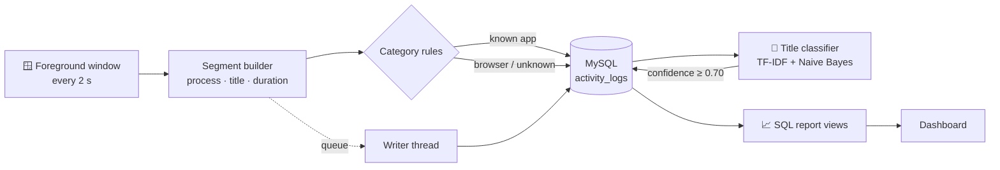

<div align="center">


<p>
  
  
  
  
  
  
  
</p>

**A study and work tracker for Windows.** It records which app and window you are using, splits your time into sessions, labels activity as *Productive*, *Neutral* or *Distracting*, and can block distracting apps while you focus.

[Features](#-features) · [How it works](#-how-it-works) · [Getting started](#-getting-started) · [Project structure](#-project-structure) · [Roadmap](#-roadmap)

</div>

---

## ✨ Features

<table>
<tr>
<td width="50%" valign="top">

### 🖥️ Activity monitor
Polls the foreground window (Win32 `GetForegroundWindow`) and records the process, window title, start/end time and duration of every stretch of activity.

</td>
<td width="50%" valign="top">

### 🧵 Non-blocking writes
The monitor pushes finished segments into a thread-safe queue; a separate **writer thread** saves them to MySQL, so slow database calls never delay tracking. On exit the queue is drained before the program stops.

</td>
</tr>
<tr>
<td valign="top">

### 🏷️ Rule-based + AI categories
Known apps are labelled by rules (e.g. `code.exe` → Productive, `discord.exe` → Distracting). Browser tabs are harder, so a **TF-IDF + Naive Bayes** model classifies their window titles, and only applies a label when it is at least 70% confident.

</td>
<td valign="top">

### 🎯 Focus Mode
Pass `--focus` and FocusOs minimises any app on your block list the moment it comes to the front, or closes it with `--terminate`.

</td>
</tr>
<tr>
<td valign="top">

### 💤 Idle detection
Uses `GetLastInputInfo` to notice when there has been no keyboard or mouse input (default: 120 s), so time away from the desk isn't counted as work.

</td>
<td valign="top">

### 📊 Reports
SQL views give productivity per session, app usage per session and a day-by-day summary. A Flask dashboard serves totals, daily charts, top apps and recent activity.

</td>
</tr>
</table>

## 🧠 How it works



1. **Monitor** (`monitor/`, C++17): watches the active window and builds a *segment* every time the app or title changes.
2. **Writer thread**: takes segments off the queue and inserts them into MySQL with prepared statements.
3. **Classifier** (`ai/`, Python): trains on titles you have labelled yourself, then relabels *Neutral* browser titles it is confident about.
4. **Reports** (`db/logic.sql`): views such as `vw_session_productivity` and `vw_daily_productivity` turn raw logs into productivity percentages.

## 🚀 Getting started

> **Requirements:** Windows 10/11 · CMake ≥ 3.20 · a C++17 compiler (Visual Studio) · MySQL Server 8.0 · Python 3.10+

<details>
<summary><b>1. Configure the database</b></summary>

Create `monitor/config.ini` (it is git-ignored, so your password stays local):

```ini
[database]
host = 127.0.0.1
port = 3306
user = focus_user
password = change-me
database = study_tracker

[monitor]
poll_seconds = 2
```

</details>

<details>
<summary><b>2. Build and run the monitor</b></summary>

```powershell
cd monitor
cmake -B build -S .
cmake --build build --config Release
.\build\Release\focus_monitor.exe
```

`CMakeLists.txt` expects MySQL at `C:/Program Files/MySQL/MySQL Server 8.0`; change `MYSQL_ROOT` if yours is elsewhere. Press **Ctrl+C** to stop. Queued activity is saved before it exits.

</details>

<details>
<summary><b>3. Train and run the title classifier</b></summary>

```powershell
pip install scikit-learn joblib mysql-connector-python
python ai/title_classifier.py train                     # needs ≥ 15 labelled titles
python ai/title_classifier.py classify --threshold 0.7
```

</details>

<details>
<summary><b>4. Focus Mode (tracker)</b></summary>

```text
focus_tracker [options]
  --db <path>        SQLite file (default focus.db)
  --idle <sec>       idle threshold in seconds (default 120)
  --poll <sec>       polling interval (default 1)
  --focus            enable Focus Mode (block 'distracting' apps)
  --block <exe>      extra process to block (repeatable)
  --terminate        kill blocked apps instead of minimising
```

</details>

## 🗂️ Project structure

```text
FocusOs/
├── monitor/      C++17 activity monitor → MySQL (producer/consumer queue)
├── tracker/      C++ tracker → SQLite: sessions, idle detection, Focus Mode
│   └── dashboard/  Flask API + static dashboard
├── ai/           TF-IDF + Naive Bayes window-title classifier
├── db/           SQL categories and report views
└── prototype/    first Python version (psutil + pywin32 → CSV)
```

## 🛣️ Roadmap

- [x] Python prototype logging to CSV
- [x] C++ monitor with a background writer thread
- [x] Rule-based categories and SQL reports
- [x] AI classification of browser titles
- [x] Idle detection and Focus Mode
- [ ] Merge `monitor` (MySQL) and `tracker` (SQLite) into one app
- [ ] Commit the dashboard's data modules and add screenshots
- [ ] Let users edit category rules from the dashboard

## 🔒 Privacy

Everything stays on your computer: window titles are stored only in your local database and never sent anywhere.

<div align="center">


</div>
